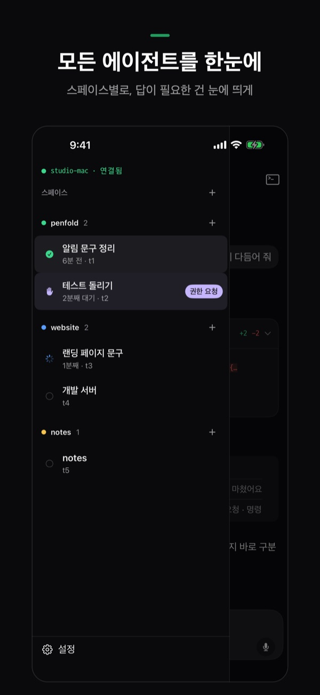
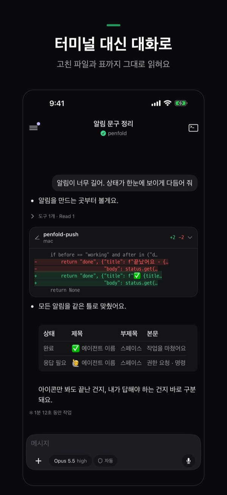
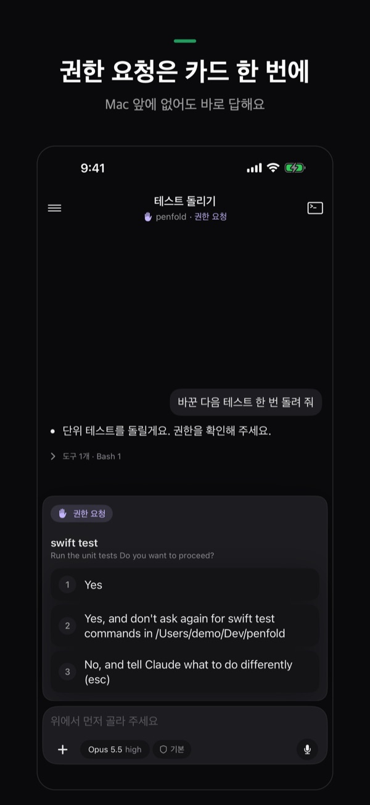
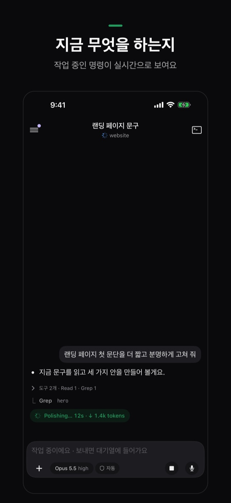
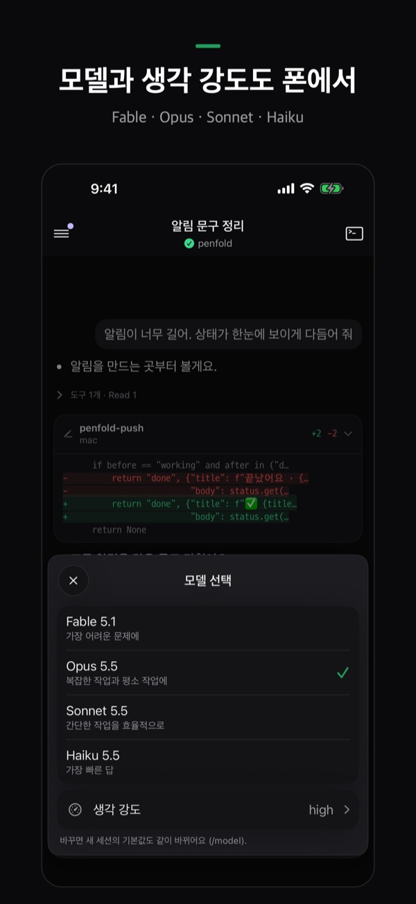
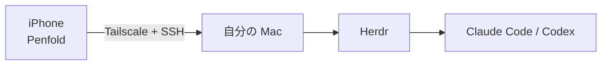

<p align="center">
  
</p>

<h1 align="center">Penfold</h1>

<p align="center">
  Mac で動くコーディングエージェントを、iPhone から確認・返信・新規起動。<br>
  <a href="README.md">English</a> · <a href="README.ko.md">한국어</a> · <b>日本語</b> · <a href="README.zh-CN.md">简体中文</a>
</p>

<p align="center">
  
  
  
  
  
</p>

> **現在の状況:** iPhone アプリは App Store での公開を準備中です。このリポジトリには Mac 側の準備(1 行セットアップとペアリング用スクリプト)が入っています。
>
> スクリーンショットは韓国語版です。アプリの表示言語は韓国語と英語です。

Penfold は、**自分の Mac** で動くコーディングエージェント(Claude Code、Codex)のための iPhone アプリです。エージェントは机の上の Mac で働かせたまま、どれが終わったか、どれが返事を待っているかをスマホで確認し、その場で返信できます。

> [!IMPORTANT]
> **[Herdr](https://herdr.dev) 専用です。** Penfold に表示されるのは Herdr の中で起動したエージェントだけです。ターミナル.app や iTerm で直接起動した `claude`・`codex` は表示されません。Herdr のタブか、Penfold の ＋ から起動してください。macOS 専用です。

## できること

| | |
|---|---|
| **すべてのエージェントをひと目で** | Herdr のスペースごとにまとめて表示。返事が必要なエージェントは目立ち、何分待っているかもわかります。 |
| **ターミナルではなく会話で** | Claude Code のセッションはチャットとして読めます。続いたツール呼び出しは 1 行にまとまり、変更したファイルは `+追加 −削除` のカードに、Markdown の表は表として表示されます。 |
| **権限リクエストはタップするだけ** | エージェントが「続けますか?」と聞くと、選択肢がカードで出ます。タップして答えるだけ。Mac の前にいなくても大丈夫です。 |
| **いま何をしているか** | 作業中のエージェントが、どのコマンドを何秒実行しているかをリアルタイムで表示します。 |
| **モデルと思考の強さもスマホから** | 入力欄の上のチップで、モデル(Fable・Opus・Sonnet・Haiku)、思考の強さ、権限モードを切り替えられます。 |
| **通知** | エージェントが返事を待っているときや作業が終わったときに、iPhone に通知します。 |
| **新しい作業を始める** | Mac のフォルダを選ぶとそこでシェルが開き、ボタンひとつで Claude Code や Codex を起動できます。 |
| **写真・ファイル・音声** | 写真やファイルを添付したり、音声入力したりできます。IME の入力は確定した文字列としてまとめて送るので、文字が崩れません。 |
| **Mac なしで試す** | 最初の画面の **Try without a Mac**(韓国語では「Mac 없이 둘러보기」)で、セットアップなしにすべての画面をサンプルのエージェントで試せます。 |

## 仕組み



- 間に **Penfold のサーバーはありません。** iPhone は自分の Tailscale ネットワーク経由で、SSH で Mac に直接つながります。
- SSH 鍵は iPhone 上で作成され、キーチェーンに保管されます。Mac のホスト鍵はペアリング時に固定され、変わった場合は接続を拒否します。
- 端末の外に出るのは通知だけです。Mac が Penfold の小さな中継サーバーに渡し、中継サーバーは何も保存せずに Apple Push Notification service へ転送します。

## 必要なもの

- 席を離れている間も起きている Mac(macOS)— 電源につないでおいてください
- [Herdr](https://herdr.dev) と、インストール・ログイン済みの Claude Code または Codex
- Mac と iPhone の **両方** に [Tailscale](https://tailscale.com)(同じアカウント)
- Penfold を入れた iPhone

下のセットアップで、エージェント以外はすべてインストールまたは有効化できます。

## Mac の準備(最初の 1 回)

Mac のターミナルに次の 1 行を貼り付けてください。

```sh
curl -fsSL https://raw.githubusercontent.com/SihyunAdventure/penfold-mac/main/setup | zsh
```

ファイルは `~/.penfold` にダウンロードされ、1 ステップずつ確認していきます。何かをインストールする前には必ず確認します(Enter = はい)。

1. **開発者ツール** — Penfold は Mac の `python3` を使います
2. **Tailscale** — インストール・ログイン・オン
3. **リモートログイン(SSH)** — 共有設定を開き、22 番ポートが開くまで待ちます
4. **Herdr** — herdr-core(`hc`)と Herdr アプリ、そして Claude Code か Codex があるかを確認します(エージェントは各自でインストール・ログインしてください)
5. **通知** — エージェントが返事を待っているときや終わったときに iPhone に知らせます。エージェントの作業中は Mac をスリープさせません
6. **ペアリング** — ターミナルに QR コードが表示されます

何度実行しても安全です。終わったステップは確認だけします。メッセージは Mac の言語に合わせて韓国語か英語で表示されます(日本語の Mac では英語)。Homebrew は不要です。QR は macOS の Core Image で描画します。

```sh
~/.penfold/setup            # もう一度実行
~/.penfold/setup --check    # 何も変えずに状態だけ表示
~/.penfold/penfold-pair     # ペアリング用 QR をもう一度表示
```

## iPhone をつなぐ

1. iPhone で Tailscale がオンになっていることを確認します。
2. Mac のターミナルに QR が出たら、iPhone の **カメラ** アプリで読み取ります。
3. Penfold が開いたら **Connect** をタップ。これで完了です。

QR には Mac のアドレス・ユーザー・Herdr セッション・Mac のホスト鍵・ワンタイムトークンが入っています。ペアリング用スクリプトは Tailscale のアドレスでだけ 120 秒待ち受け、正しいトークンのリクエストを 1 件受け取ると、iPhone の公開鍵を `~/.ssh/authorized_keys` に(コメント `penfold-iphone` 付きで)追加して終了します。

## よくある質問

**エージェントが一覧に出てきません。** 表示されるのは Herdr の中で起動したものだけです。Herdr のタブで起動し直すか、Penfold の ＋ から起動してください。

**Mac につながりません。** iPhone と Mac の両方で Tailscale がオンになっていて同じアカウントか、Mac がスリープしていないかを確認してください。アプリの **Settings › Connection status** で、どの段階で止まっているかがわかります。

**通知が来ません。** **Settings › Alerts** で、この iPhone の許可、Mac の通知デーモン、登録状態を確認し、テスト通知を送ってみてください。

**コードや会話がどこかに送られますか?** いいえ。アプリは自分の Mac とだけ通信します。詳しくは[プライバシーポリシー](https://sihyunadventure.github.io/penfold-mac/privacy.html)をご覧ください。

## このリポジトリのファイル

| ファイル | 役割 |
|---|---|
| `setup` | 上の 1 行セットアップ |
| `penfold-pair` | ペアリング用 QR を表示し、iPhone の鍵を登録します |
| `penfold-push` | Herdr を見守り、iPhone に通知を送ります |
| `install-push`、`co.notique.penfold-push.plist` | `penfold-push` をバックグラウンド(launchd)で動かします |
| `docs/` | サポートサイト https://sihyunadventure.github.io/penfold-mac/ |

## お問い合わせ

質問・不具合・アイデアは [GitHub Issues](https://github.com/SihyunAdventure/penfold-mac/issues) へどうぞ。
