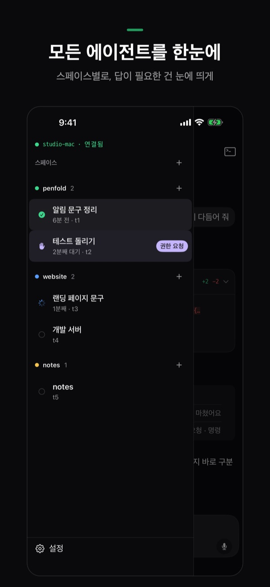
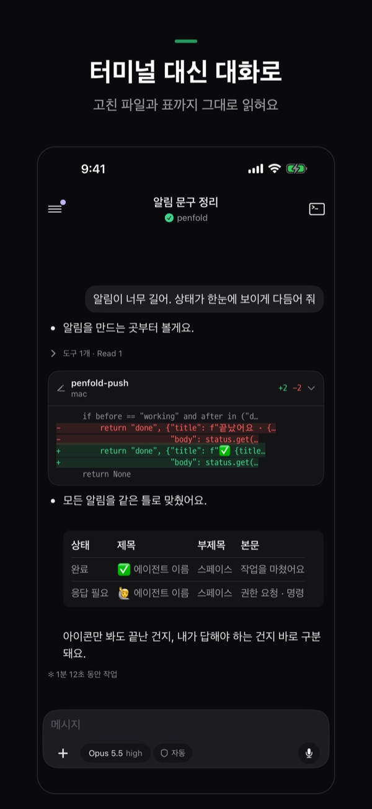
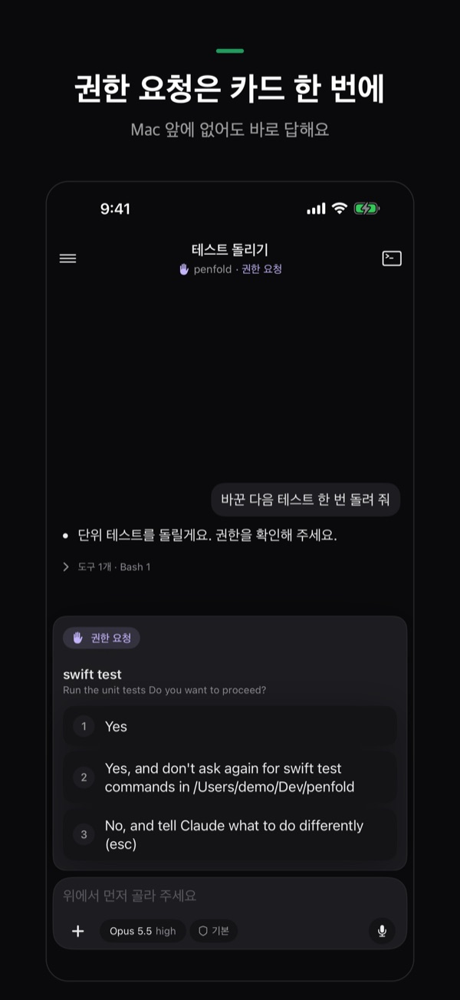
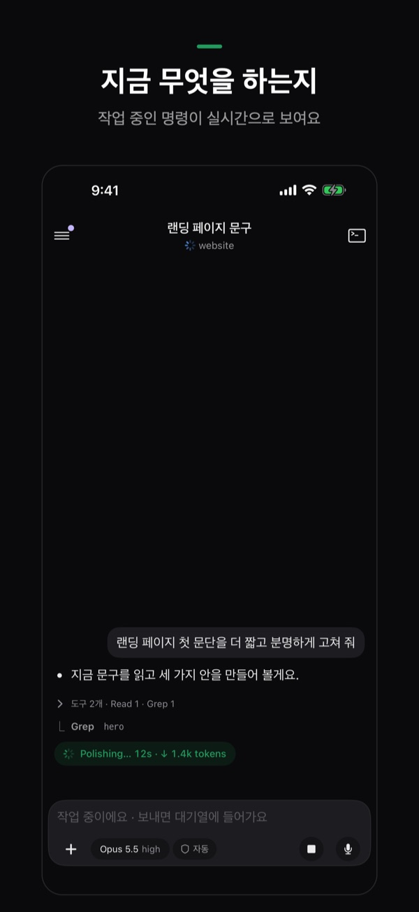
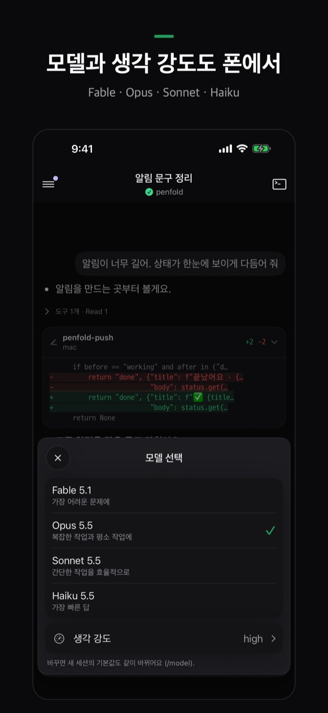
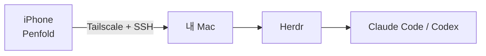

<p align="center">
  
</p>

<h1 align="center">Penfold</h1>

<p align="center">
  Mac에서 일하는 코딩 에이전트를 iPhone에서 보고, 답하고, 새로 시작해요.<br>
  <a href="README.md">English</a> · <b>한국어</b> · <a href="README.ja.md">日本語</a> · <a href="README.zh-CN.md">简体中文</a>
</p>

<p align="center">
  
  
  
  
  
</p>

> **지금 상태:** iPhone 앱은 App Store 출시를 준비하고 있어요. 이 저장소에는 Mac 쪽 준비(한 줄 설치, 연결 스크립트)가 들어 있어요.

Penfold는 **내 Mac**에서 돌아가는 코딩 에이전트(Claude Code, Codex)를 위한 iPhone 앱이에요. 에이전트는 책상 위 Mac에서 계속 일하게 두고, 어떤 게 끝났는지, 어떤 게 내 답을 기다리는지 폰으로 보고 그 자리에서 답해요.

> [!IMPORTANT]
> **[Herdr](https://herdr.dev) 전용이에요.** Penfold는 Herdr 안에서 실행한 에이전트만 보여요. 터미널 앱이나 iTerm에서 바로 띄운 `claude`·`codex`는 보이지 않아요. Herdr 탭에서 시작하거나 Penfold의 ＋로 시작하세요. macOS 전용이에요.

## 할 수 있는 것

| | |
|---|---|
| **모든 에이전트를 한눈에** | Herdr 스페이스별로 묶어 보여요. 답이 필요한 에이전트는 눈에 띄고, 몇 분째 기다리는지도 나와요. |
| **터미널 대신 대화로** | Claude Code 세션은 채팅처럼 읽혀요. 이어진 도구 호출은 한 줄로 접히고, 고친 파일은 `+추가 −삭제` 카드로, Markdown 표는 표로 보여요. |
| **권한 요청은 카드 한 번에** | 에이전트가 "진행할까요?"라고 물으면 선택지가 카드로 떠요. 눌러서 답하면 끝, Mac 앞에 없어도 돼요. |
| **지금 무엇을 하는지** | 작업 중인 에이전트가 지금 어떤 명령을 몇 초째 실행하는지 실시간으로 보여요. |
| **모델과 생각 강도도 폰에서** | 입력창 위 칩으로 모델(Fable·Opus·Sonnet·Haiku), 생각 강도, 권한 모드를 바꿔요. |
| **알림** | 에이전트가 답을 기다리거나 작업을 마치면 iPhone으로 알려요. |
| **새 작업 시작** | Mac의 폴더를 고르면 거기서 셸이 열리고, 버튼 하나로 Claude Code나 Codex를 시작해요. |
| **사진·파일·음성** | 사진이나 파일을 붙이고, 말로 받아쓸 수 있어요. 한글은 조합이 끝난 글자로 한 번에 보내서 자모가 쪼개지지 않아요. |
| **Mac 없이 둘러보기** | 첫 화면의 **Mac 없이 둘러보기**로 설치 없이 모든 화면을 예시 에이전트와 함께 써 볼 수 있어요. |

## 어떻게 연결되나요



- 중간에 **Penfold 서버가 없어요.** iPhone이 내 Tailscale 네트워크를 거쳐 SSH로 Mac에 직접 연결해요.
- SSH 키는 iPhone에서 만들어 Keychain에 둬요. Mac의 호스트 키는 연결할 때 고정하고, 키가 바뀌면 연결을 막아요.
- 기기 밖으로 나가는 건 알림뿐이에요. Mac이 Penfold의 작은 중계 서버로 보내면, 중계 서버는 아무것도 저장하지 않고 Apple 푸시 알림 서비스로 전달만 해요.

## 준비물

- 자리를 비울 때도 깨어 있는 Mac(macOS) — 전원에 연결해 두세요
- [Herdr](https://herdr.dev), 그리고 설치·로그인된 Claude Code 또는 Codex
- Mac과 iPhone **둘 다** [Tailscale](https://tailscale.com), 같은 계정
- Penfold가 설치된 iPhone

아래 설치가 에이전트를 뺀 나머지를 설치하거나 켜 줘요.

## Mac 준비 (처음 한 번)

Mac 터미널에 아래 한 줄을 붙여 넣으세요.

```sh
curl -fsSL https://raw.githubusercontent.com/SihyunAdventure/penfold-mac/main/setup | zsh
```

파일은 `~/.penfold` 에 받아지고, 한 단계씩 확인해요. 설치 전에는 항상 물어봐요(Enter = 예).

1. **개발자 도구** — Penfold가 Mac에서 `python3`를 써요
2. **Tailscale** — 설치·로그인·켜기
3. **원격 로그인(SSH)** — 공유 설정 창을 열고 22번 포트가 열릴 때까지 기다려요
4. **Herdr** — herdr-core(`hc`)와 Herdr 앱, 그리고 Claude Code나 Codex가 있는지 확인해요(에이전트는 직접 설치·로그인해 두세요)
5. **알림** — 에이전트가 답을 기다리거나 끝나면 iPhone에 알려요. 에이전트가 일하는 동안 Mac이 잠들지 않게 해요
6. **iPhone 연결** — 터미널에 QR이 떠요

다시 실행해도 괜찮아요. 끝난 단계는 확인만 해요. 안내 문구는 Mac 언어를 따라요(한국어 또는 영어, `PENFOLD_LANG=ko`로 고정). Homebrew는 필요 없어요. QR은 macOS 기본 기능(Core Image)으로 그려요.

```sh
~/.penfold/setup            # 다시 실행
~/.penfold/setup --check    # 바꾸지 않고 상태만
~/.penfold/penfold-pair     # 연결용 QR만 다시
```

## iPhone 연결

1. iPhone에서 Tailscale이 켜져 있는지 확인해요.
2. Mac 터미널에 QR이 뜨면 iPhone 기본 **카메라**로 찍어요.
3. Penfold가 열리면 **연결**을 눌러요. 끝이에요.

QR에는 Mac 주소·사용자·Herdr 세션·Mac 호스트 키·일회용 토큰이 들어 있어요. 연결 스크립트는 Tailscale 주소에서만 120초 동안 기다리고, 토큰이 맞는 요청 하나를 받으면 iPhone 공개 키를 `~/.ssh/authorized_keys`에 `penfold-iphone` 주석으로 추가하고 끝나요.

## 자주 묻는 것

**에이전트가 목록에 안 보여요.** Herdr 안에서 실행한 것만 보여요. Herdr 탭에서 다시 시작하거나 Penfold의 ＋로 시작하세요.

**Mac에 연결이 안 돼요.** iPhone과 Mac 모두 Tailscale이 켜져 있고 같은 계정인지, Mac이 잠자기 상태가 아닌지 확인하세요. 앱의 **설정 › 연결 상태**가 어느 단계에서 막혔는지 보여 줘요.

**알림이 안 와요.** **설정 › 알림**에서 이 iPhone 허용, Mac의 알림 데몬, 등록 상태를 확인하고 시험 알림을 보내 보세요.

**제 코드나 대화가 어딘가로 가나요?** 아니요. 앱은 내 Mac과만 통신해요. 자세한 내용은 [개인정보처리방침](https://sihyunadventure.github.io/penfold-mac/privacy.html)을 보세요.

## 이 저장소의 파일

| 파일 | 하는 일 |
|---|---|
| `setup` | 위의 한 줄 설치 |
| `penfold-pair` | 연결용 QR을 띄우고 iPhone 키를 등록해요 |
| `penfold-push` | Herdr를 지켜보다가 iPhone으로 알림을 보내요 |
| `install-push`, `co.notique.penfold-push.plist` | `penfold-push`를 백그라운드(launchd)로 돌려요 |
| `docs/` | 지원 사이트 https://sihyunadventure.github.io/penfold-mac/ |

## 문의

문제나 제안은 [GitHub Issues](https://github.com/SihyunAdventure/penfold-mac/issues)에 남겨 주세요.
