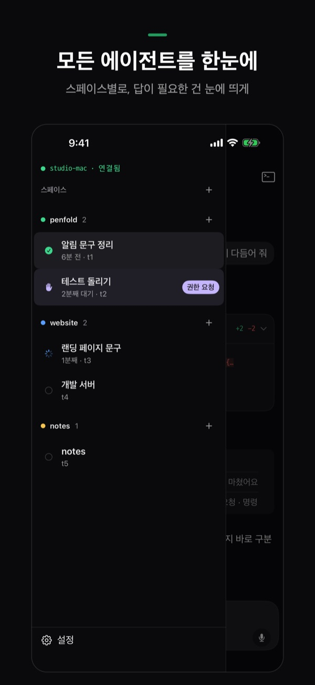
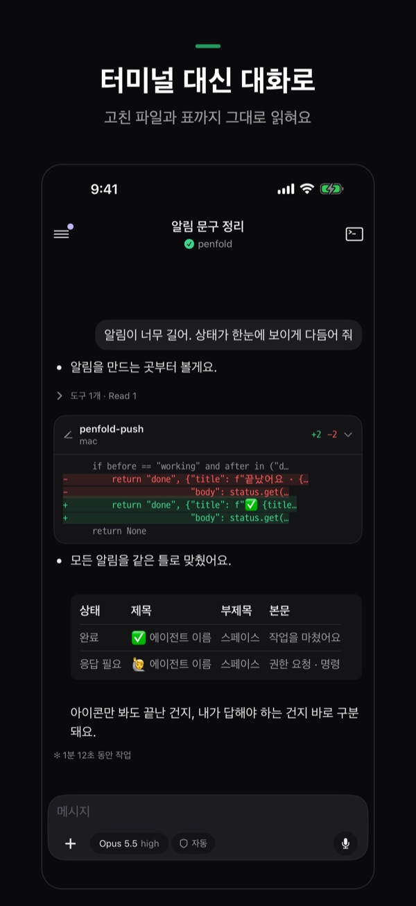
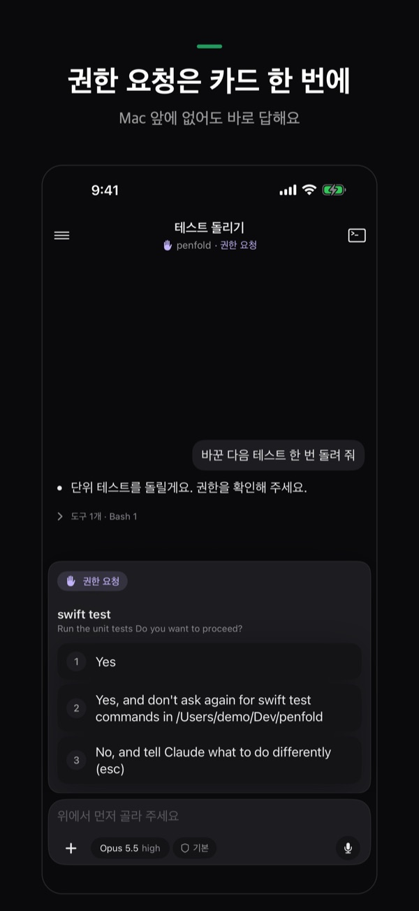
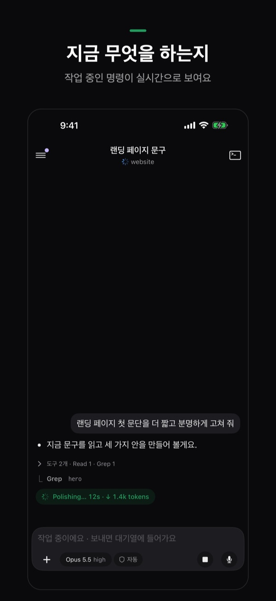
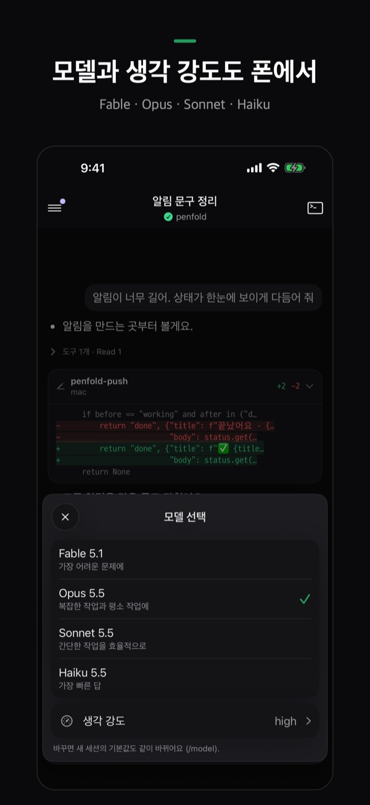
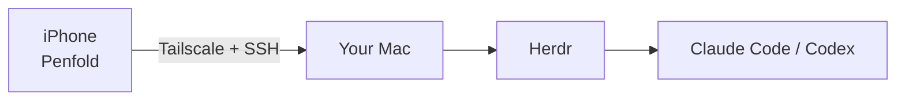

<p align="center">
  
</p>

<h1 align="center">Penfold</h1>

<p align="center">
  Watch, answer and start the coding agents on your Mac — from your iPhone.<br>
  <b>English</b> · <a href="README.ko.md">한국어</a> · <a href="README.ja.md">日本語</a> · <a href="README.zh-CN.md">简体中文</a>
</p>

<p align="center">
  
  
  
  
  
</p>

> **Status:** the iPhone app is getting ready for the App Store. This repository holds the Mac side: the one-line setup and the pairing script. Screenshots show the Korean version; the app is in English and Korean.

Penfold is an iPhone app for the coding agents (Claude Code, Codex) running on **your own Mac**. You leave the agents working at your desk; Penfold shows you which ones are done, which are waiting for you, and lets you reply from wherever you are.

> [!IMPORTANT]
> **Penfold works with [Herdr](https://herdr.dev) only.** It shows agents running inside Herdr, not ones started straight from Terminal or iTerm. Start them in a Herdr tab, or with the ＋ button in Penfold. macOS only.

## What you can do

| | |
|---|---|
| **All agents at a glance** | Agents are grouped by Herdr space. The ones that need an answer stand out, with how long they've been waiting. |
| **A chat, not a terminal** | Claude Code sessions read as a conversation. Tool calls fold into one line; edited files show as cards with `+added −removed` lines; Markdown tables render as tables. |
| **Permission requests in one tap** | When an agent asks "Do you want to proceed?", the options appear as a card. Tap one — no need to be at the Mac. |
| **Live progress** | While an agent works, you see the command it's running right now and how long it's been at it. |
| **Model and effort from your phone** | Change the model (Fable, Opus, Sonnet, Haiku), thinking effort and permission mode from the chips above the input. |
| **Alerts** | Your iPhone gets a notification when an agent needs you or finishes. |
| **Start new work** | Pick a folder on the Mac, open a shell there, and start Claude Code or Codex with one button. |
| **Photos, files, voice** | Attach a photo or file, or dictate a message. Korean and other IME input is sent as finished text, so characters never break apart. |
| **Try without a Mac** | The first screen has **Try without a Mac** (Mac 없이 둘러보기): every screen with sample agents, no setup. |

## How it works



- There is **no Penfold server** in the middle. The iPhone talks to your Mac directly over SSH, through your own Tailscale network.
- The SSH key is created on the iPhone and kept in its Keychain. The Mac's host key is pinned at pairing; if it changes, Penfold refuses to connect.
- The only thing that leaves your devices is the alert: your Mac hands it to Penfold's small relay, which passes it on to Apple Push Notification service and stores nothing.

## What you need

- A Mac (macOS) that stays awake while you're away — keep it plugged in
- [Herdr](https://herdr.dev), plus Claude Code or Codex installed and logged in
- [Tailscale](https://tailscale.com) on **both** the Mac and the iPhone, same account
- An iPhone with Penfold

The setup below installs or turns on everything except the agents themselves.

## Set up the Mac (once)

Paste this into the Mac's Terminal:

```sh
curl -fsSL https://raw.githubusercontent.com/SihyunAdventure/penfold-mac/main/setup | zsh
```

It downloads to `~/.penfold` and goes one step at a time. It always asks before installing anything (Enter = yes):

1. **Developer tools** — Penfold uses `python3` on the Mac
2. **Tailscale** — install, log in, turn on
3. **Remote Login (SSH)** — opens the Sharing settings and waits until port 22 is open
4. **Herdr** — herdr-core (`hc`) and the Herdr app, and checks that Claude Code or Codex is there (install and log in to those yourself)
5. **Alerts** — tells your iPhone when an agent needs you or finishes; keeps the Mac awake while agents work
6. **Pairing** — shows a QR code in Terminal

Running it again is safe: finished steps are only checked. Messages follow the Mac's language (Korean or English; `PENFOLD_LANG=en` forces English). No Homebrew needed — the QR is drawn with macOS Core Image.

```sh
~/.penfold/setup            # run again
~/.penfold/setup --check    # report only, change nothing
~/.penfold/penfold-pair     # show the pairing QR again
```

## Pair your iPhone

1. Make sure Tailscale is on on the iPhone.
2. When the QR appears in the Mac's Terminal, point the iPhone's **Camera** app at it.
3. Penfold opens — tap **Connect**. Done.

The QR holds the Mac's address, user, Herdr session, the Mac's host key and a one-time token. The pairing script listens only on the Tailscale address for 120 seconds, accepts one request with the right token, adds the iPhone's public key to `~/.ssh/authorized_keys` (comment `penfold-iphone`) and exits.

## FAQ

**My agent isn't in the list.** Only agents running inside Herdr show up. Restart it in a Herdr tab, or start one from Penfold's ＋.

**Penfold can't reach the Mac.** Check that Tailscale is on on both devices with the same account, and that the Mac isn't asleep. In the app, **Settings › Connection status** shows which step is failing.

**No alerts.** In **Settings › Alerts**, check that this iPhone is allowed, the Mac's alert daemon is running and the device is registered, then send a test alert.

**Do my code or conversations go anywhere?** No. The app talks only to your Mac. See the [privacy policy](https://sihyunadventure.github.io/penfold-mac/privacy.html).

## What's in this repo

| File | What it does |
|---|---|
| `setup` | The one-line setup above |
| `penfold-pair` | Shows the pairing QR and adds the iPhone's key |
| `penfold-push` | Watches Herdr and sends alerts to the iPhone |
| `install-push`, `co.notique.penfold-push.plist` | Runs `penfold-push` in the background (launchd) |
| `docs/` | The support site, https://sihyunadventure.github.io/penfold-mac/ |

## Support

Questions, problems, ideas: [GitHub Issues](https://github.com/SihyunAdventure/penfold-mac/issues).
