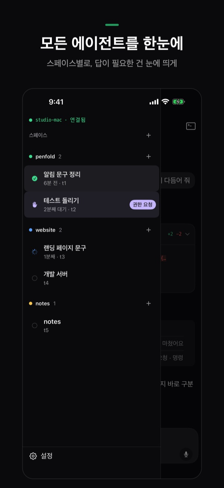
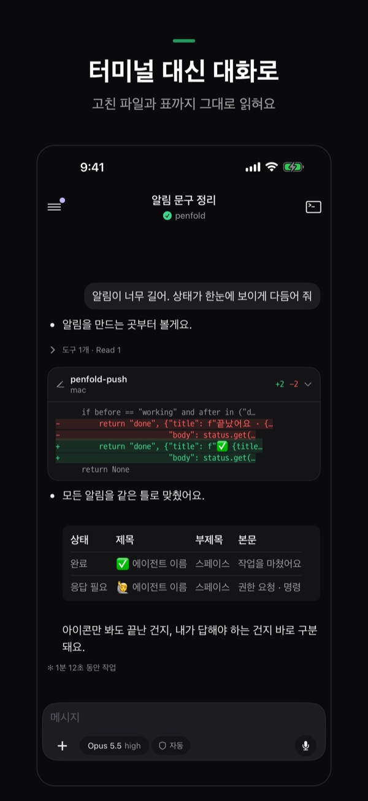
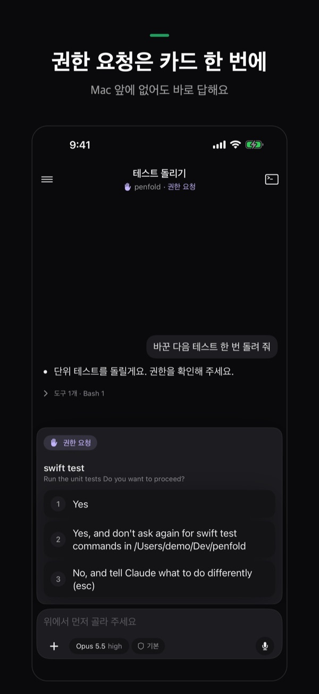
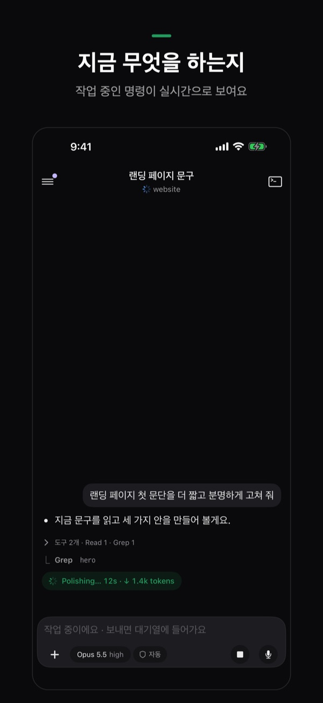
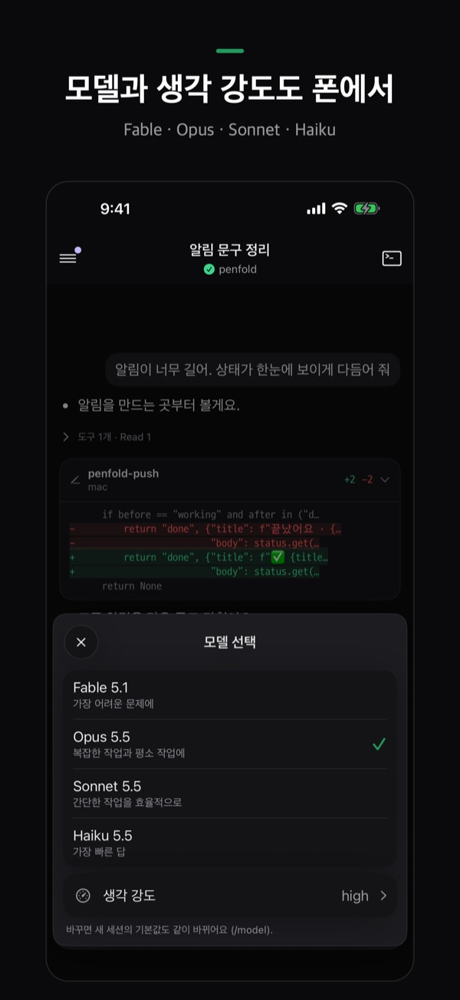
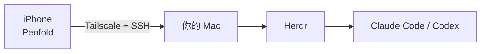

<p align="center">
  
</p>

<h1 align="center">Penfold</h1>

<p align="center">
  在 iPhone 上查看、回复、启动你 Mac 上的编程智能体。<br>
  <a href="README.md">English</a> · <a href="README.ko.md">한국어</a> · <a href="README.ja.md">日本語</a> · <b>简体中文</b>
</p>

<p align="center">
  
  
  
  
  
</p>

> **当前状态:** iPhone 应用正在准备上架 App Store。本仓库包含 Mac 端的准备工作(一行安装命令和配对脚本)。
>
> 截图为韩语版。应用界面支持韩语和英语。

Penfold 是一款 iPhone 应用,用于管理在**你自己的 Mac** 上运行的编程智能体(Claude Code、Codex)。让智能体在桌上的 Mac 里继续工作,你可以用手机看到哪些已经完成、哪些在等你回复,并随时随地回复。

> [!IMPORTANT]
> **仅支持 [Herdr](https://herdr.dev)。** Penfold 只显示在 Herdr 中运行的智能体,直接在“终端”或 iTerm 里启动的 `claude`、`codex` 不会显示。请在 Herdr 的标签页中启动,或使用 Penfold 的 ＋ 按钮。仅支持 macOS。

## 功能

| | |
|---|---|
| **所有智能体一目了然** | 按 Herdr 空间分组显示。需要你回复的智能体会被突出显示,并标出已经等待了多久。 |
| **用对话代替终端** | Claude Code 会话以聊天形式呈现。连续的工具调用折叠成一行,修改过的文件显示为 `+新增 −删除` 卡片,Markdown 表格按表格显示。 |
| **权限请求一点即答** | 智能体询问“是否继续?”时,选项会以卡片形式出现。点一下即可回答,不必守在 Mac 前。 |
| **实时进度** | 智能体工作时,可以实时看到它正在运行哪条命令、已经运行了多久。 |
| **在手机上切换模型和思考强度** | 通过输入框上方的标签切换模型(Fable、Opus、Sonnet、Haiku)、思考强度和权限模式。 |
| **通知** | 智能体等待回复或完成工作时,会通知你的 iPhone。 |
| **开始新工作** | 选择 Mac 上的文件夹即可在那里打开 shell,一个按钮启动 Claude Code 或 Codex。 |
| **照片、文件、语音** | 可以附加照片或文件,也可以语音输入。输入法的文字会在确认后整段发送,不会出现乱码或断字。 |
| **无需 Mac 即可试用** | 首屏的 **Try without a Mac**(韩语界面为“Mac 없이 둘러보기”)无需任何设置,即可用示例智能体体验所有界面。 |

## 工作原理



- 中间**没有 Penfold 服务器**。iPhone 通过你自己的 Tailscale 网络,用 SSH 直接连接 Mac。
- SSH 密钥在 iPhone 上生成,保存在钥匙串中。Mac 的主机密钥在配对时固定,若发生变化,Penfold 会拒绝连接。
- 唯一离开你设备的是通知:由 Mac 通过 Apple 推送通知服务发送(当 Mac 没有自己的推送密钥时,会经过一个不保存任何内容的小型中继)。

## 准备条件

- 一台在你离开时也保持唤醒的 Mac(macOS)——请接上电源
- [Herdr](https://herdr.dev),以及已安装并登录的 Claude Code 或 Codex
- Mac 和 iPhone **都**安装 [Tailscale](https://tailscale.com),并使用同一账号
- 安装了 Penfold 的 iPhone

下面的安装命令会帮你安装或开启除智能体以外的所有内容。

## 准备 Mac(只需一次)

在 Mac 的终端中粘贴下面这一行:

```sh
curl -fsSL https://raw.githubusercontent.com/SihyunAdventure/penfold-mac/main/setup | zsh
```

文件会下载到 `~/.penfold`,然后逐步检查。安装任何东西之前都会先询问(回车 = 是)。

1. **开发者工具** —— Penfold 会在 Mac 上使用 `python3`
2. **Tailscale** —— 安装、登录、开启
3. **远程登录(SSH)** —— 打开“共享”设置,等待 22 端口开启
4. **Herdr** —— herdr-core(`hc`)和 Herdr 应用,并检查是否已有 Claude Code 或 Codex(智能体请自行安装并登录)
5. **通知** —— 智能体等待回复或完成时通知你的 iPhone;智能体工作期间让 Mac 保持唤醒
6. **配对** —— 终端中会显示二维码

重复运行是安全的,已完成的步骤只做检查。提示信息跟随 Mac 的语言显示韩语或英语(中文系统显示英语)。不需要 Homebrew,二维码由 macOS 的 Core Image 绘制。

```sh
~/.penfold/setup            # 再次运行
~/.penfold/setup --check    # 只查看状态,不做任何更改
~/.penfold/penfold-pair     # 重新显示配对二维码
```

## 连接 iPhone

1. 确认 iPhone 上的 Tailscale 已开启。
2. Mac 终端中出现二维码后,用 iPhone 自带的**相机**扫描。
3. Penfold 打开后点 **Connect**,完成。

二维码中包含 Mac 的地址、用户名、Herdr 会话、Mac 的主机密钥和一次性令牌。配对脚本只在 Tailscale 地址上等待 120 秒,收到一个令牌正确的请求后,把 iPhone 的公钥添加到 `~/.ssh/authorized_keys`(注释为 `penfold-iphone`),然后退出。

## 常见问题

**列表里没有我的智能体。** 只显示在 Herdr 中运行的智能体。请在 Herdr 标签页中重新启动,或通过 Penfold 的 ＋ 启动。

**连不上 Mac。** 确认 iPhone 和 Mac 都开启了 Tailscale 且使用同一账号,并且 Mac 没有睡眠。应用中的 **Settings › Connection status** 会显示卡在哪一步。

**收不到通知。** 在 **Settings › Alerts** 中检查本机是否允许通知、Mac 的通知守护进程以及注册状态,然后发送一条测试通知。

**我的代码或对话会被发送到别处吗?** 不会。应用只与你自己的 Mac 通信。详见[隐私政策](https://sihyunadventure.github.io/penfold-mac/privacy.html)。

## 仓库里的文件

| 文件 | 作用 |
|---|---|
| `setup` | 上面的一行安装命令 |
| `penfold-pair` | 显示配对二维码并登记 iPhone 的密钥 |
| `penfold-push` | 监视 Herdr,向 iPhone 发送通知 |
| `install-push`、`co.notique.penfold-push.plist` | 让 `penfold-push` 在后台(launchd)运行 |
| `docs/` | 支持网站 https://sihyunadventure.github.io/penfold-mac/ |

## 反馈

问题、故障或建议,请提交到 [GitHub Issues](https://github.com/SihyunAdventure/penfold-mac/issues)。
